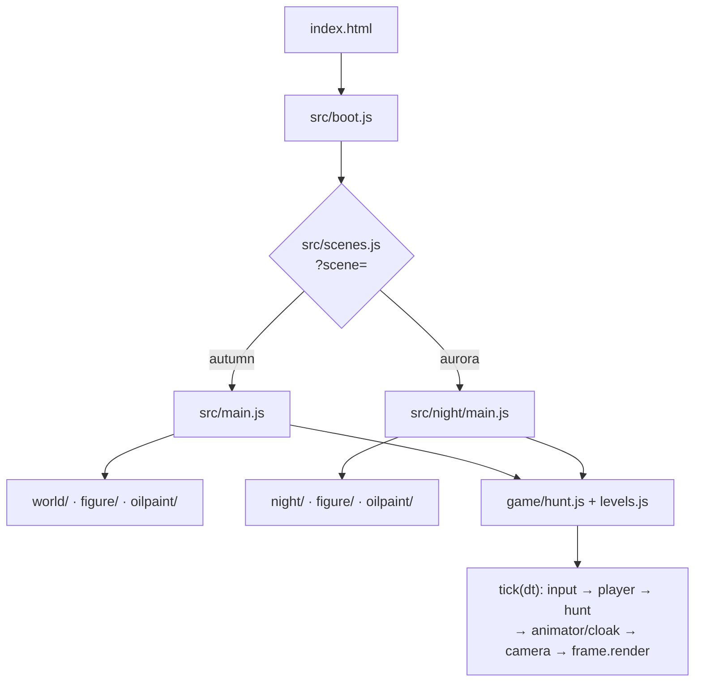
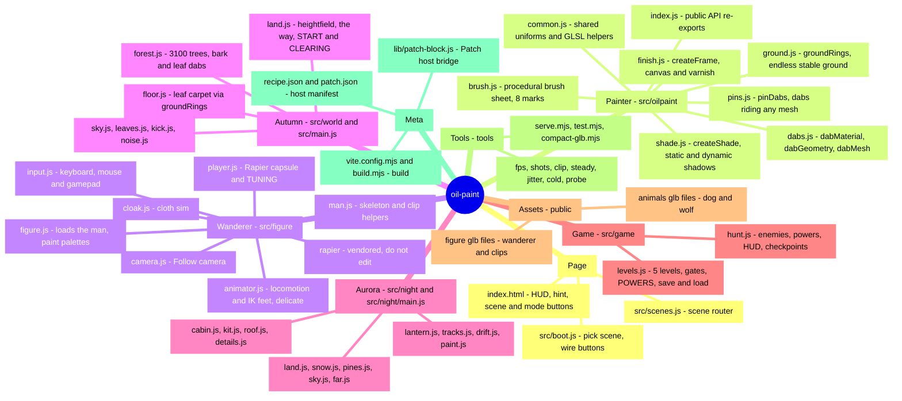

# AGENTS.md — oil-paint

Instructions and navigation for coding agents working in this repository.
Read this first, then the file headers — every source file opens with a
paragraph saying what it does, and those headers are the ground truth.

## What this is

A three.js (0.186.1) WebGL2 demo that renders a scene as thick oil paint:
every object is a brush **dab** pinned to the world, never a post-process
filter. Two playable scenes share one wanderer:

- **Aurora** (`?scene=aurora`, default): snowy ridge, cabin, night sky.
- **Autumn** (`?scene=autumn`): a wood with a level-based game on top —
  5 gated levels, checkpoints, unlockable powers, bigger enemies, free roam.

Vanilla ES modules, no framework, no TypeScript. Vite for dev/build.
Rapier (vendored) for character physics. No test framework: correctness is
checked with `node <file>` demo functions and headless `tools/*.mjs`.

## Run, build, verify

```bash
npm install
npm run dev          # vite dev server → http://127.0.0.1:5406
npm run build        # production build into dist/ (runs node build.mjs)
npm run serve        # serves dist/ on :5405 (tools/serve.mjs)

node src/game/hunt.js      # balance/logic demo: throws on any broken rule
node src/game/levels.js    # level-data validation
node --check <file>        # syntax-check any edited module
node tools/fps.mjs --seconds 8   # frame-rate of the built page (needs browser)
```

Key URLs (dev server):

| URL | What |
|---|---|
| `?scene=autumn` | Level game (default mode) |
| `?scene=autumn&mode=roam` | Free roam |
| `?scene=autumn&fresh` | Ignore the saved checkpoint |
| `?scene=aurora` | Night scene |
| `?quality=low` | Fewer pixels/leaves, no sun-shafts (perf fallback) |
| `?capture` / `?clean` | Deterministic stepping / no HUD chrome (tools) |

In the browser, `window.lab` is the test handle: `teleport(x,z,fx,fz)`,
`step(dt,n)`, `setInput(fn)`, `view(eye,target)`, and `window.lab.hunt`
exposes `hp`, `power`, `seg`, `powers`, `roam`, `won`, `enemies`.

## Startup flow



Both scenes follow the same shape: build shared uniforms, land, paint,
figure, physics, then a `tick(dt)` loop driven by
`renderer.setAnimationLoop`. Scene switching reloads the page with a new
`?scene=` — it is deliberately *not* a live control.

## Repository mindmap



## Module map — where to make a change

| Change | Files | Notes |
|---|---|---|
| Level layout, spawns, gates | `src/game/levels.js` | Pure data; keep gates ordered down the way (z decreasing) |
| Enemy stats / AI / damage | `src/game/hunt.js` (`KIND`, `HIT`) | Then run `node src/game/hunt.js` |
| New power | `levels.js` (`POWERS`, `grant`) + `hunt.js` (`has()`, update) + `input.js` | Gate with `has(key)`; show locked toast; add a HUD pill |
| Controls | `src/figure/input.js` | One `read(dt)` state; keep keyboard + pad in sync. `F`=heavy, `J`/click=swing, `Q`=spark, `E`=dash, `R`=flare, `M`=mode |
| Movement / jump / speed | `src/figure/player.js` (`TUNING`) | Rapier kinematic capsule; don't move the body except via `player` APIs or `holdAt`-style teleports |
| Animation feel | `src/figure/animator.js` | Largest, most delicate file — small changes, check feet |
| A painted object | `src/oilpaint/dabs.js` or `pins.js` + scene file | Write `makeDab` GLSL; pick colours via `paint3(light, half, shade)` |
| Ground look | `src/world/floor.js`, `src/night/snow.js`, `oilpaint/ground.js` | Ground dabs must never swim — fixed cells only |
| New tree/plant | `src/world/forest.js` / `src/night/pines.js` | Reuse dab counts; watch the leaf budget |
| Sky / aurora / mist | `src/world/sky.js`, `src/night/sky.js`, `oilpaint/common.js` | Shared uniforms live in `common.js` |
| HUD / page chrome | `index.html` + HUD block in `hunt.js` | HUD is created in JS (`#hud`); styles in `index.html` |
| Night-scene gameplay | `src/night/main.js` | Passes `marks`/`spots` to `createHunt` — keep that API working |
| Perf regression hunt | `tools/fps.mjs`, `?quality=low` | Compare before/after; see Performance below |

## Core concepts an agent must not break

1. **Nothing is tone-mapped.** Colours are paint: every surface supplies
   three mixes (light / half-tone / shade) and `paint3` in GLSL chooses by
   light at the dab. Never add lighting, tone mapping, or sRGB conversion
   to "fix" a colour — change the palette.
2. **Dab order never depends on the camera.** Overlapping-stroke order is
   fixed in the world. Any change that sorts by view direction will make
   the paint crawl. Ground dabs belong to fixed ground cells (`ground.js`).
3. **Distance simplifies, never swaps.** Far dabs grow and stand in for
   neighbours; objects are never replaced by LOD models.
4. **`heightAt(x, z)` is the single ground truth** (`src/world/land.js`,
   mirrored in `src/night/land.js`). Physics, placement, enemies and the
   shader map all read it. Never approximate terrain height locally.
5. **Shadows:** still world baked once (`createShade`), moving things get
   a per-frame soft glaze. Don't shadow dabs per-pixel for movers.
6. **Shared uniforms** (`createShared` in `common.js`): sun, wind, mist,
   brush/height/land textures, `uTime`, `uPixel`, `uFocus`, lamp. Every
   material reads them; add a uniform there, not per-material.

## Game rules (autumn)

- Way runs `START (0, 78)` → `CLEARING (11, -96)`; levels gate it into 5
  segments. A level clears when all its enemies are dead; its gate opens
  and the next cairn becomes reachable. Cairns set the respawn point and
  heal. Death calls `down()` (respawn in `src/main.js`) and resets nearby
  enemies — enemies never respawn in level mode.
- Power order: spark → dash → heavy → flare (`POWER_ORDER`). Powers are
  *derived* from cleared count via `powersFor()` — never store the power
  list itself. Save is `{ cleared, x, z }` under
  `localStorage["oilpaint.levels.v1"]`; if the save throws, the game must
  toast once ("Progress is not saving…"), never swallow it silently.
- Enemy kinds: `dog`, `wolf`, `brute` (brute = wolf rig, scale 2.35,
  dark palette, 330 HP). Balance invariants are asserted in `demo()` at
  the bottom of `hunt.js` — extend them when you change `HIT`/`KIND`.
- Free roam: no gates, all powers, enemies respawn after 20 s, cairns
  heal repeatedly (10 s cooldown). Roam never writes the level save.
- Back-compat: `createHunt` without `levels` (night scene) must keep the
  old behaviour — one-shot cairns, `F` swings, no powers HUD.

## Performance — it is fine, keep it that way

The paint pass dominates (hundreds of thousands of instanced dabs);
game logic is negligible **if** these rules hold:

- Enemies stay rigged GLB clones with painted materials — no per-enemy
  render targets, post passes, or unique shaders.
- Cap work by distance: enemies beyond ~36 m skip AI (`hunt.js` already
  does this). Keep total spawns modest (~16 today).
- Respect `renderer.setPixelRatio(min(devicePixelRatio, 1.5))` and the
  `?quality=low` path. Don't raise either.
- Verify with `node tools/fps.mjs --seconds 8` before/after any rendering
  or spawn-count change; a >5% fps regression needs a reason in the PR.

## Conventions

- Plain ES modules (`.js`), `import`/`export`, no build-time macros.
  Two-space indent, single quotes in new code, comments explain *why*
  (see existing headers — match that voice, keep them short).
- No new dependencies without a strong reason; three + vite + vendored
  Rapier are the whole stack. Check `package.json` before importing.
- Files end with a `demo()` / `demoLevels()` self-check where logic is
  pure (`hunt.js`, `levels.js`). Run them after edits; add assertions
  for new invariants instead of deleting failing ones.
- `dist/`, `node_modules/`, `.test/` are generated — never edit or commit
  them (see `.gitignore`). Screenshots for the README live in `shots/`.
- Never edit `src/figure/rapier/` or `public/**/*.glb` binaries by hand;
  `tools/compact-glb.mjs` is the sanctioned way to shrink clip files.
- Commit messages in history are `Release x.y.z: …` — only commit when
  asked; leave the working tree for review otherwise.

## Common recipes

**Tune difficulty:** edit `HIT` / `KIND` in `hunt.js` → `node src/game/hunt.js`
→ play level 5 (brutes must fall to ~5 heavy swings, wolves survive sparks).

**Move a checkpoint/gate:** edit `LEVELS` in `levels.js` → keep checkpoint
z above its gate z, gates strictly decreasing → `node src/game/levels.js`
(it throws on unordered gates) → clear the save (`?fresh`) when playtesting.

**Add an enemy kind:** add `KIND` + `HIT` + `PAL` entries, map it in
`beastMesh` (reuse a rig), add spawns to `levels.js`, extend `demo()`.

**Debug without playing:** `window.lab.teleport(...)` in the console,
`tools/probe.mjs` headless, or `?capture` + `window.lab.step(dt, n)`.

## Gotchas

- Pointer lock: first click locks the mouse *and* must not swing — attack
  only registers when already locked (`input.js`). Headless tools use
  `tools/no-pointer-lock.mjs`.
- `?capture` disables the hunt entirely; don't "fix" missing enemies there.
- The aurora scene has its own `heightAt`/land — don't import autumn's.
- `animator.js` and `cloak.js` are stateful per-frame; teleporting the
  player must reset `feet`/`prevFeet`/`visualY` (see `respawn()` and
  `holdAt` in `hunt.js`) or the figure will streak.
- If no browser is available in the environment, say so honestly:
  build + `node` demos + syntax checks are the fallback verification,
  not proof the game plays. State what was not exercised.
