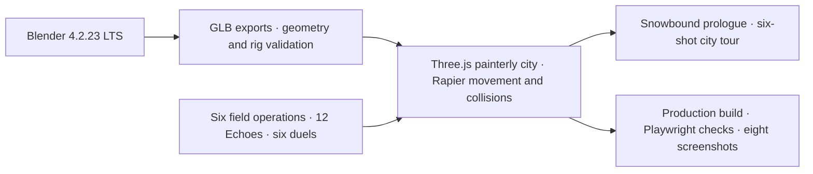

# Komorebi: Protocol Zero-Seven

A third-person action adventure set in Neo-Kyoto, five years after the Silent
Autumn. You play Kael, Courier 07, carrying Dr. Mira’s Komorebi Seed through
Aethelgard’s Eternity Grid. Recover twelve Memory Echo Shards, duel Ren’s six
Neural Specters, and reach Amber Sanctuary Spire. **Snowbound** is the playable
prologue, *Memory 00 // Ridge Above Old Kyoto*.

## Play locally

```sh
npm install
npm run dev
```

Open [localhost:5406](http://127.0.0.1:5406). Click the world to capture the
mouse, then click again or press J to strike. Escape opens the pause menu with
the Codex, audio and graphics settings, and mode selection. Music and spoken
radio comms start after a user gesture. Radio voices use browser speech with
procedural audio as a fallback.

On a phone or tablet, choose **Full screen** or **Normal screen** before loading.
Use the left stick to move and drag the world to look. **Dash** and **Powers**
appear when earned. While driving, **Jump** becomes **Brake** and the vehicle
prompt becomes **Exit vehicle**.

| Action | Keyboard / mouse | Gamepad |
|---|---|---|
| Move | WASD / arrows | Left stick |
| Look / zoom | Mouse / wheel | Right stick / d-pad |
| Sprint | Shift | L3 toggle / RB |
| Jump / short hop | Hold / tap Space | Hold / tap A |
| Strike | J / left click | X |
| Lock / next target | T / Y | D-pad left / right |
| Quickstep | X | RT |
| Guard | Hold Z | Hold LT |
| Spark | Q | Y |
| Dash | E | B |
| Heavy strike | F | LB |
| Flare | R | Start |
| Whirl | C | R3 |
| Vehicle in / out / right a stopped wreck | G | Back |
| Drive / handbrake | WASD / Space | Left stick / A |
| Pause / controls | Escape / P / H | — |

Touch devices have a movement stick, camera drag, jump and ability buttons. Snowbound also supports V for first person; the cabin switches to it automatically. F remains a normal strike in Snowbound.

Lock a hostile to circle it and aim strikes. Start a combo with forward and Strike to close in with an advancing cut. Quickstep in any direction or backstep from rest. A guard covers attacks from the front and consumes guard strength. Raise it just before impact, release it, and strike to counter. Evade Ren’s overhead slam.

Enemy crews take turns pressing you in melee while their allies flank. Gunners look for a clear lane and use a close-range stock strike if rushed. Punks and blades sidestep a windup, enforcers brace and answer with a shield bash, and the mech can armor through light hits. Gold signals a guard and orange signals an unblockable windup. Break a guard with Heavy, Whirl, or Flare, or move around its front.

Ren’s Specters build from a single sweep to thrusts, paired cuts, sidesteps, guard ripostes, and feints. Wait for the green recovery cue before committing to a punish.

## Campaign and preview

| District | Earned ability |
|---|---|
| Sunleaf Row | Spark |
| Petal Arcade | Dash |
| Jade Heights | Heavy strike |
| Moonveil Stacks | Flare |
| Ashen Hollow | Whirl |
| Amber Sanctuary | Sanctuary victory |

Each district pairs a field operation with a crew fight and a mirror duel.
Read the telegraph, evade the attack, and use the recovery window. Relays heal
and save the campaign. Two Echo Shrines per district unlock entries in the
Memory Codex. Free Roam opens the city and all powers. Online City uses the
room server from `npm run room` and has its own quick-match and private rooms.

| URL query | Experience |
|---|---|
| `?scene=autumn&fresh` | Start a fresh campaign |
| `?scene=autumn&mode=roam` | Explore the city freely |
| `?scene=autumn&mode=online` | Join an open room |
| `?scene=aurora` | Play the Snowbound prologue |
| `?scene=autumn&tour=1` | Start the six-shot Investor Showcase |
| `?phase=day` or `?phase=night` | Open in the chosen lighting phase |
| `?quality=high`, `medium`, or `low` | Fix the graphics setting |

The pause menu also switches between day and night in a running solo game.
`?clean` hides the HUD. `?capture` is for deterministic camera tools and disables
the hunt.

## Rendering, physics and assets

Neo-Kyoto uses instanced towers, painted clouds, detailed windows and neon
signs. Street fixtures tint their surroundings and cast broken reflections
across wet asphalt. Filtered markings and distance-tinted ink keep the scene
readable at speed. Auto graphics adjusts scenery detail, resolution and
anti-aliasing in both scenes. High, Balanced and Low can also be selected live
in the pause menu.

Rapier sweeps the player capsule through movement, dashes and knockback. Jumps
have an input buffer and a short ledge grace period. The city follow camera
sweeps a sphere around its near plane, retracts on contact and eases back out.
Vehicles use an arcade handling model with independent wheel travel, damped
suspension, weight transfer, progressive tyre grip, handbrake slides, ramming
and rollovers. Parked vehicles and traffic share the same collision system.
Press G beside a stopped overturned vehicle to right it.

Twenty-six procedural Blender GLBs cover the Cyber-Katana, Ren’s odachi,
Spirit Lantern, shrine, ramen stall, service props, five civilians, five foes,
five vehicles and seated rider. The vertex-colour shader reads baked ambient
occlusion and a separate emissive material. Rigged street characters have
at least six skeletal clips. The traveler and rivals use **Seed-san by
VirtualCast, Inc.** with the game’s locomotion rig and original gear.
See [asset provenance and the Blender 4.2.23 LTS build](public/street/SOURCE.md).



## Build and verify

```sh
npm run build
npm run serve
```

In another terminal, set `CHROME` to your Chrome or Chromium executable and run:

```sh
node src/game/hunt.js
node src/game/ride.js
node src/game/story.js
node src/game/daynight.js
node src/game/showcase.js
node src/game/net.js
node src/quality.js
node server/room.mjs --check
node tools/assets.mjs
node tools/combat.mjs
node tools/enemies.mjs
node tools/gameplay.mjs
node tools/street.mjs
node tools/graphics.mjs
node tools/mobile.mjs
node tools/fps.mjs --seconds 8 --query quality=high
node tools/capture-investor-shots.mjs
```

The Playwright gameplay, street, graphics and mobile scripts use the production
server on port 5405 by default. Compare FPS back to back at a fixed quality and
resolution. The capture script opens a local server for `dist/` and writes
eight 1600×900 PNGs under `shots/`.

The `window.lab` debug handle exposes `player`, `hunt`, `rides`,
`teleport(x,z,fx,fz)`, `step(dt,n)`, `setInput(fn)` and `view(eye,target)`.
Headless scripts use `tools/no-pointer-lock.mjs` to keep the real cursor free.

## Credits

Code is MIT. Original procedural art is CC0 or MIT as credited at its source.
Seed-san uses the VRM Public License 1.0. Three.js is MIT and Rapier is
Apache-2.0. See [LICENCE-NOTES.md](LICENCE-NOTES.md) and
[the asset credits](public/CREDITS.md).

## Original painter reference

The sections below document the retained paint engine. Neo-Kyoto and Snowbound use the cel treatment described above.

### Paint engine concepts

Nothing is filtered after the picture is drawn. Everything is a **dab**: one touch of a loaded brush, in one mixed colour, pinned to a point of the world and turned to lie along a direction of the world (the grain of a trunk, the fall of a cloak).

- **Colour is paint, not light.** A thing has three mixes (light, half-tone, shade). Each dab picks one from how lit its spot is, then is mixed a little differently from its neighbours. Nothing is tone-mapped, so you choose colours as they should look on the canvas.
- **The brush** is a sheet of eight marks made in code: where there is paint, how thick it stands, and a streak of a second colour. A light from the upper left of the canvas rakes across the thickness.
- **Distance simplifies.** Dabs keep between a least and a most size on the canvas, so far things are painted with fewer, larger touches.
- **The ground stays put.** Its dabs lie flat on it, real patches of the surface, each at its own small height, so they overlap in one fixed order and never turn with the eye. Every dab belongs to one small square of ground for good. With distance, one in four is drawn larger to stand for its neighbours; as you come nearer it shrinks back where it lies and the others grow in round it. Nothing is swapped for something else.
- **Nothing is put in order by the eye.** Which of two overlapping strokes is on top must never depend on where the camera is, or the paint crawls as you breathe. Near things are given a depth each. Far things (ranges, water, sky) are too far apart for a depth to tell them from each other, so they are laid in one fixed order, far to near.
- **Shade.** The still world's shade is drawn once from the sun (or the moon), and a dab takes it whole, so a shadow's edge is a ragged line of whole dabs. A moving thing's shadow would make dabs flick as it passed, so it goes over the ground as a soft glaze, pixel by pixel.
- **Light that is light.** A few things are painted in strokes that add up instead of covering: the aurora, a flame, the glow round a candle. A carried lamp (`uLamp`) turns what is near it toward that thing's own warm colour.
- **Mist** puts distance between one row of things and the next. In the wood, the one thing that is not a dab is the sun standing in that mist, found by walking each line of sight through the shade.

### Using the paint engine

It owns the picture: a three.js `WebGLRenderer` (WebGL2), its own render target and final pass, and every material. Your scene, camera and game loop stay yours. Built on three 0.186.

```js
import * as THREE from 'three';
import { createShared, createBrushSheet, dabMaterial, dabGeometry, dabMesh, groundRings, pinDabs, createShade, createFrame } from './src/oilpaint/index.js';

const renderer = new THREE.WebGLRenderer({ antialias: false });
renderer.autoClear = false;
renderer.outputColorSpace = THREE.LinearSRGBColorSpace; // colours are paint: written as they are

const shared = createShared();              // sun, wind, mist, maps: every material reads these
shared.tBrush.value = createBrushSheet();
// shared.tHeight / shared.tLand: your ground's height and a map of what lies where (see src/world/land.js)

// 1. dabs of your own: positions in buffers, colour and direction decided in GLSL
const mesh = dabMesh(dabGeometry(count, { aPos: [positions, 3] }), dabMaterial(shared, {
  head: `in vec3 aPos;`,
  body: `void makeDab(inout Dab d) {
    float lit = sunAt(aPos);
    vec4 r = hash4(float(gl_InstanceID));
    d.pos = aPos;
    d.dir = vec3(0.0, 1.0, 0.0);                       // the way the stroke runs
    d.size = vec2(0.2, 0.5);                           // across and along, metres
    d.c1 = hazed(jitter(paint3(LIGHT, HALF, SHADE, lit, r.x), r.yzw, 0.5), aPos);
    d.c2 = d.c1 * 1.15;                                // the colour streaked into it
  }`,
}));

// 2. a ground with no end (see src/world/floor.js for the leaf carpet, src/night/snow.js for snow)
const carpet = groundRings(shared, { body: carpetGLSL, per: 3, n: 192, cell0: 0.14, levels: 6, minPx: [5, 9], maxPx: [4000, 4000], cells: [0, 8] });

// 3. paint on any mesh, rigged or not: pins spread over its surface and carried with it
const paint = pinDabs(shared, [[light, half, shade]], [{ mesh: model, count: 500, style: (p, n) => ({ pal: 0, size: [0.06, 0.12], dir: UP }) }]);
scene.add(mesh, carpet.group, paint.mesh);

// 4. shade and the canvas
const shade = createShade(renderer, shared, stillThingsScene);   // the still world, once
const frame = createFrame(renderer, shared);

function tick() {
  shared.uTime.value = time;
  shared.uPixel.value = (2 * Math.tan(THREE.MathUtils.degToRad(camera.fov) / 2)) / drawingBufferHeight;
  carpet.follow(camera.position.x, camera.position.z);
  paint.update();                    // after the model has moved
  shade.update(scene, heroPosition); // the moving thing's shadow: draws the meshes on layer 1
  frame.render(scene, camera);
}
```

In `makeDab` you have `paint3` (the three mixes), `jitter` (broken colour), `hazed` (mist), `sunAt` / `woodSunAt` (shade), `lampAt` (a carried light), `gustAt` (wind), `heightAt` / `normalAt` (the ground) and `hash4`. Set `d.lie = 1.0` with `d.nrm` and `d.height` for a dab that lies on a surface, `d.glaze = 1.0` for one the moving shadow passes over, and `d.base = 1.0` for one pinned by its foot (a blade of grass, a ray of the aurora). `createShade` takes the sun's direction and how much of the world its picture of the shade must hold.

For **made things** (a cabin, furniture, pots) there is a kit in `src/night/kit.js`: give it flat faces or any geometry with the name of a palette and it keeps the faces as an underpainting and lays strokes on them along the grain, with logs and planks in courses. `src/night/cabin.js`, `roof.js` and `details.js` are a whole house built with it.

### Original module map

| | |
|---|---|
| `src/oilpaint/` | The painter: `dabs.js` (the dab), `brush.js` (the marks), `common.js` (shared uniforms and GLSL), `ground.js` (the steady ground), `pins.js` (paint on a mesh), `shade.js`, `finish.js` (the canvas) |
| `src/night/` | The aurora: `land.js` (the ridge, the horns, the fjord), `paint.js` (the night's palette), `snow.js` (snow and rock), `pines.js`, `sky.js` (stars, moon, the aurora), `far.js` (water and ranges), `cabin.js` with `kit.js`, `roof.js`, `details.js`, `lantern.js`, `tracks.js` (his footprints), `drift.js` (snow in the air), `main.js` |
| `src/world/` | The wood: `land.js` (ground and the way through), `floor.js` (leaf carpet, undergrowth), `forest.js` (about 3,100 trees: trunks, bark, about 570,000 leaf dabs), `sky.js`, `leaves.js` (falling), `kick.js` (kicked up) |
| `src/figure/` | The wanderer: Patch's starter man and his movement (`man.js`, `animator.js`, `player.js`, `input.js`), his hat, and `cloak.js`, a cloth of points on threads kept off his body and under the hat's brim |
| `src/main.js`, `src/scenes.js`, `src/boot.js` | The wood's demo; which picture is shown; the page's start |
| `tools/` | Headless stills (`shots.mjs`), a film (`clip.mjs`), frame time (`shots.mjs --time`, `fps.mjs`), steadiness (`steady.mjs` for the ground, `jitter.mjs` for anything), the scene switch (`switch.mjs`), a first visit (`cold.mjs`), a clip file rewritten with only what its clips use (`compact-glb.mjs`) |

### Paint engine limits

- three.js on WebGL2 only. It is not a node material and does not run on WebGPU.
- Almost everything is opaque: there is no glass, and water is strokes that give back the sky, not a mirror of the world.
- Paint materials use three-colour palettes; the anime character shader can additionally retain an albedo atlas.
- Historical paint-engine measurements on an RTX 4090 at 1080p: about 4.5 ms a frame in the aurora, about 4.6 in the wood. `?quality=low`, or Patch's performance mode, draws less (in the aurora: fewer pixels, no veil behind the curtains, less snow in the air; in the wood: no sun in the mist, fewer falling leaves).
- The demo downloads about 9 MB, 5 of it code and the rest the wanderer and his clips. A first visit is ready in about 4 seconds on a fast machine and a 30 Mbit/s line.
- Each scene is one hour of one day. Walk off the ridge into the fjord, or more than 78 m from the way in the wood, and you are put back at the start.
- Through his own eyes you see no body or hands.
