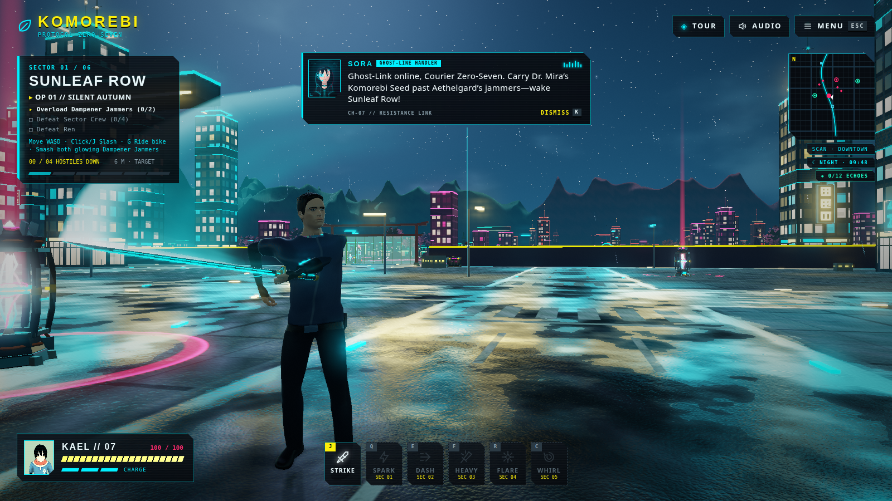

# Komorebi: Protocol Zero-Seven (Unreal Engine 5 C++)

Native cross-platform **Unreal Engine 5.4 / 5.5 LTS C++20** action-RPG & open-street cyberpunk city running natively on **Linux (Vulkan SM5)**, **macOS (Metal SM5 — Apple Silicon & Intel Universal)**, and **Windows (DX12 / Vulkan)** with **zero JavaScript or Node.js runtime dependencies**.



## Worlds & Features

- **Neo-Kyoto (Six-Sector Campaign & Free Roam)**:
  - 720m × 720m procedural street grid (`15×15` avenues/streets) + winding central spirit trail + 3 woodland parks + perimeter alpine mountains (`KomorebiCore::NeoKyotoTerrainMap`).
  - Dynamic **10-minute Day/Night cycle** with smooth 12-second twilight transitions, 6 chapter neon palettes (`Sunleaf Row` → `Amber Sanctuary`), and SM5-compatible PBR + HDR Bloom + optional **Comic Ink / Oil-Paint Impasto** post-process finish toggle.
  - **Protagonist & Swordplay (`AKaelCharacter`, `UCombatComponent`)**: Responsive movement (coyote time, jump buffer, ground + single air dash, quickstep evade, plunge slam), 7-move procedural katana combo (`Cut`, `Backhand`, `Thrust`, `Heavy`, `Spin`, `Counter`, `Advance`), dual-layer neon blade trails, Guard / Parry / Perfect Dodge slow-motion, lock-on targeting, and 5 unlockable powers (`Q` Spark, `E` Dash, `F` Heavy, `R` Flare, `C` Whirl).
  - **Enemies, Mirror Duels & Street Consequences (`UEnemySquadSubsystem`, `ARenBossCharacter`)**: 5 enemy archetypes (`Punk`, `Enforcer`, `Gunner`, `Blade`, `Brute` Siege Mech) with squad slot tactics, 6 Ren Mirror Duels with live telegraph arenas, 4 civilian archetypes + hooded couriers/thieves, and Guilt / Witness Mob / 3-Star Police & Roadblock Heat escalation.
  - **5 Drivable Vehicles & Autonomous Traffic (`AKomorebiVehiclePawn`, `UTrafficSubsystem`)**: `Kestrel`, `Kestrel GT`, `Parcel Van`, `Razor Bike`, and `Courier Scooter` with 120 Hz arcade tyre/suspension/OBB-collision/rollover physics, vehicle ramming, hull smoke/fire/wreck states, wreck righting (`G`), and yielding street traffic.
  - **Story, Missions, Codex & Investor Tour (`UMissionSubsystem`, `AShowcaseCameraDirector`)**: 6 sector field operations, 12 collectible Memory Echo Shrines, 8 repeatable \$150 Street Contract Kiosks, 3-tab Story & Memory Codex (`6-Act Story`, `Cast Dossiers`, `12 Echoes`), and the 6-shot automated Investor Showcase camera tour.
  - **Real-Time Procedural C++ DSP Audio (`UKomorebiSynthComponent`)**: Lock-free Unreal AudioMixer synthesizer (Linux PipeWire/PulseAudio/ALSA, macOS CoreAudio, Windows WASAPI) generating 6-chapter D-Dorian synthwave music, Aurora E-minor bells, continuous RPM vehicle engine/drift audio, 48-voice SFX, and 3-band biquad vowel-formant radio voices.
- **Snowbound Prologue (`L_Snowbound`)**:
  - Alpine snow fjord ridge (`KomorebiCore::SnowboundTerrainMap`), distant mountain silhouettes, Brothers' log cabin exterior & warm firelit interior with doorstep near-wall fade, carried Spirit Lantern, dynamic snow footprint tracks, layered Aurora Borealis sky curtains, and drifting spindrift snow.
- **8-Player Online City (Native UE5 C++ Replication)**:
  - Listen Server & Dedicated Server (`KomorebiServer`) supporting up to 8 players with separate Neo-Kyoto / Snowbound pools, shared crew AI, district contracts, 15s downed / 2s proximity teammate revives, 3-minute Siege Mech raids, 12-gate Street Races, PvP Duel Ring, shared vehicles, and unlockable Titles & Nameplate Colors.

## Repository Layout

| Directory | Purpose |
|---|---|
| `Komorebi.uproject` | UE 5.4/5.5 cross-platform project descriptor (`Linux`, `Mac`, `Windows`) |
| `Source/KomorebiCore/` | Pure C++20 engine-agnostic simulation, terrains, combat/duel/vehicle/story rules (built both by UE5 UBT and standalone CMake/CTest) |
| `Source/KomorebiGame/` | UE5 runtime module: `World/`, `Character/`, `Combat/`, `AI/`, `Vehicles/`, `Campaign/`, `Audio/`, `UI/` (pure Slate), `Network/` (native UE5 replication) |
| `Shaders/` | Cross-platform SM5 HLSL library (`KomorebiMaterialFunctions.ush`: vertex-alpha PBR decoder, 3D parallax windows, blade trails, aurora curtains, ink/impasto post-process) |
| `Config/` | SM5 cross-platform engine/input/scalability configs (`Linux/LinuxEngine.ini`, `Mac/MacEngine.ini`) |
| `Scripts/` | Blender 4.2 FBX/PNG validator & exporter (`export_fbx_from_blender.py`), headless UE5 Editor Python importer & map builder (`ue_import_and_build.py`), and one-command OS build scripts |
| `RawAssets/` | Authored Blender GLB models (`street/`, `figure/`, `enemies/`, `people/`, `vehicles/`, `characters/`) + source licenses |
| `Tests/` | Standalone CMake/CTest C++20 verification suite covering all gameplay, terrain, duel, vehicle, story, and coordinate invariants |
| `legacy-web/` | Temporary archive of the previous JS/Three.js web build (can be deleted once final UE5 packaged parity is verified) |

## Quick Start

### 1. Run Pure C++20 Core Tests (Linux / macOS / Windows — no UE install required)

```bash
cmake -S Tests -B Tests/build -G Ninja -DCMAKE_BUILD_TYPE=Release
cmake --build Tests/build
ctest --test-dir Tests/build --output-on-failure -V
```

### 2. Validate / Export 3D & Portrait Assets via Blender 4.2 LTS

```bash
BLENDER=${BLENDER:-.test/blender/blender}
"$BLENDER" --background --factory-startup --disable-autoexec --python-exit-code 1 \
  --python Scripts/export_fbx_from_blender.py -- --check
```

### 3. Build, Import Content, Cook & Package in Unreal Engine 5.4 / 5.5

**On Linux (Vulkan SM5 — Client + Dedicated Server):**
```bash
UE_ROOT=/path/to/UE_5.5 ./Scripts/build_linux.sh
# Packaged output: Saved/StagedBuilds/Linux/ & Saved/StagedBuilds/LinuxServer/
```

**On macOS (Metal SM5 Universal arm64 + x86_64 — Xcode + UE 5.4/5.5 required):**
```bash
UE_ROOT="/Users/Shared/Epic Games/UE_5.5" ./Scripts/build_macos.sh
# Packaged output: Saved/StagedBuilds/Mac/Komorebi.app
```

**On Windows (DX12 / Vulkan SM5):**
```bat
set UE_ROOT=C:\Program Files\Epic Games\UE_5.5
Scripts\build_windows.bat
```

> **Cross-OS Note**: One shared UE5 C++ source tree builds natively on Linux, macOS, and Windows. Unreal Engine requires compiling/packaging the macOS Metal `.app` bundle on macOS with Xcode.

## Controls

| Action | Keyboard / Mouse | Gamepad |
|---|---|---|
| Move / Sprint / Walk | `WASD` / `Shift` / `Alt` or `CapsLock` | Left Stick / `L3` or `RB` |
| Look / Zoom | Mouse / Scroll Wheel | Right Stick / D-Pad Up-Down |
| Jump / Handbrake (driving) | `Space` | `A` |
| Sword Strike / Heavy Cleave | Left Click or `J` / `F` | `X` / `LB` |
| Spark / Dash / Flare / Whirl | `Q` / `E` / `R` / `C` | `Y` / `B` / `Start` / `R3` |
| Guard / Quickstep Evade | Hold `Z` / `X` | Hold `LT` / `RT` |
| Lock-On / Next Target | `T` / `Y` | D-Pad Left / Right |
| Enter / Exit / Right Vehicle | `G` | `Back` / `Select` |
| Toggle Story / Roam · Pause · Dismiss Comms | `M` · `Esc`/`P`/`H` · `K` | `Menu` |
| Showcase Tour · Day/Night Toggle | `F9` (`Space` next, `Esc` exit) · `F8` | — |
